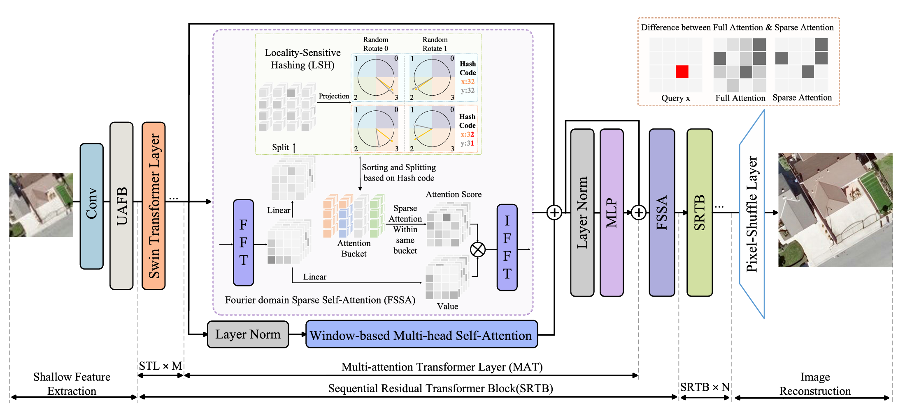
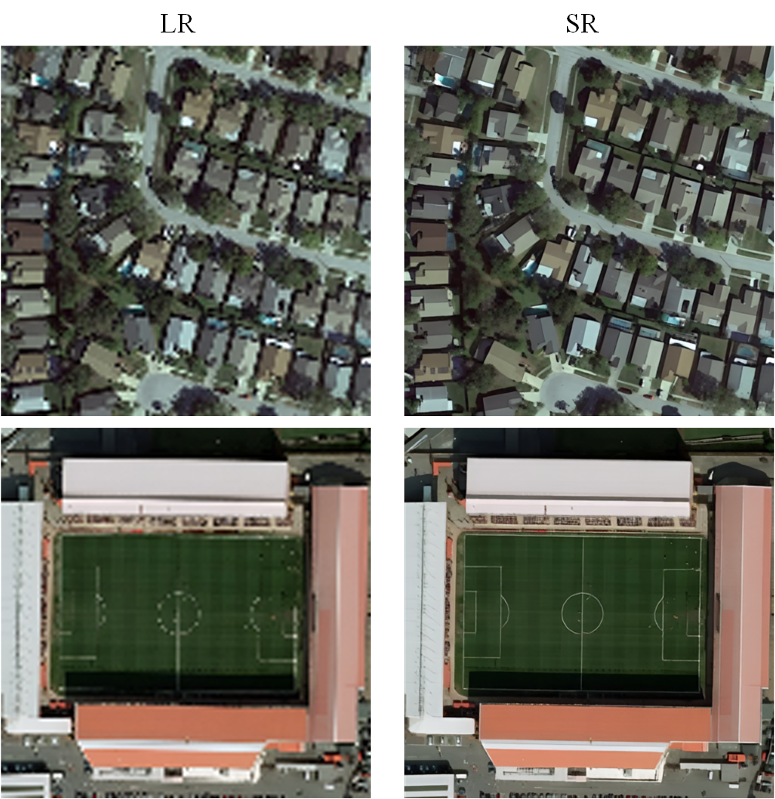

# FAT (IEEE TGRS 2025)
### Mitigating Texture Bias: A Remote Sensing Super-Resolution Method Focusing on High-Frequency Texture Reconstruction
### 抑制纹理偏见： 一种聚焦于高频纹理重建的遥感图像超分辨率方法

This repository is an official implementation of the paper "*[Mitigating Texture Bias: A Remote Sensing Super-Resolution Method Focusing on High-Frequency Texture Reconstruction](https://ieeexplore.ieee.org/document/10912673)*"

---


### :tada::tada: News :tada::tada:
- **2026/4/1**  🚀**Acknowledgments**
  The paper has received **15 citations**, which is greatly encouraging. We are particularly pleased to see citations from works influenced by FAT, such as **UEO** ([IEEE Xplore](https://ieeexplore.ieee.org/document/11367717)). We sincerely thank these authors for their efforts in reproducing our work and for providing the reproducible code and weights.
- **2025/5/20**  ✅**Code fully released**   
  *(Just finished undergrad thesis and new paper on 5/18. Who's coding frantically on 520? Oh it's me, the clown 🤡)* 
- **2025/4/8**  🚀 **Model code released**
- **2025/3/2** **RSSR25🤗 now on [HuggingFace](https://huggingface.co/datasets/fengyanzi/RSSR25/tree/main)**  
-  **2025/2/27**  **Double celebration!**  *Paper accepted by [IEEE TGRS](https://ieeexplore.ieee.org/document/10912673) 
    🎉*Another paper accepted by [CVPR 2025](https://arxiv.org/abs/2504.09621) on the same day 🏆*
- **2025/1/2**  🔍 **Paper received major revision decision**  

### :tada::tada: 新闻 :tada::tada:
- **2026/4/1**  致谢   本论文目前已获得 **15次引用**，令人倍感鼓舞。我们很高兴看到一些受FAT影响的论文（例如 **UEO** [IEEE Xplore](https://ieeexplore.ieee.org/document/11367717)。特别感谢这些作者在复现我们工作方面所做的努力，并提供了可复现的代码与权重。
- **2025/5/20**  ✅ 代码完整发布
  *(5/18刚完成本科毕设与新论文，是谁520没有女朋友陪着却在疯狂润色代码写说明？原来是我这个小丑🤡)*  
- **2025/4/8**  🚀 模型代码公开
- **2025/3/2** 🌍 RSSR25数据集登陆[HuggingFace](https://huggingface.co/datasets/fengyanzi/RSSR25/tree/main),有人报告数据有些压缩问题，还是建议从百度云中下载 🤗
-  **2025/2/27** ✨ 双喜临门！  论文被IEEE TGRS接收 🎉
  🎉* 同日另一篇论文被[CVPR 2025](https://arxiv.org/abs/2504.09621)接收 🏆
- **2025/1/2**  🔍 论文获得大修决定  


---

## Abstract
> Super-resolution (SR) is an ill-posed problem because one low-resolution image can correspond to multiple high-resolution images. High-frequency details are significantly lost in low-resolution images. Existing deep learning based SR models excel in reconstructing low-frequency and regular textures but often fail to achieve high-quality reconstruction of super-resolution high-frequency textures. These models exhibit bias toward different texture regions, leading to imbalanced reconstruction across various areas. To address this issue and reduce model bias toward diverse texture patterns, we propose a frequency-aware super-resolution method that improves the reconstruction of high-frequency textures by incorporating local data distributions. First, we introduce the Frequency-Aware Transformer (FAT), which enhances the capability of Transformer-based models to extract frequency-domain and global features from remote sensing images. Moreover, we design a local extremum and variance-based loss function, which guides the model to reconstruct more realistic texture details by focusing on local data distribution. Finally, we construct a high-quality remote sensing super-resolution dataset named RSSR25. We also discover that denoising algorithms can serve as an effective enhancement method for existing public datasets to improve model performance. Extensive experiments on multiple datasets demonstrate that the proposed FAT achieves superior perceptual quality while maintaining high distortion metrics scores compared to state-of-the-art algorithms. The source code and dataset will be publicly available at https://github.com/fengyanzi/FAT.

---
## Network  


---
## 📦 Installation
Installing the virtual environment is very ***simple***, relying only on PyTorch and some extremely basic libraries such as ***tqdm*** and ***timm***, making it difficult to conflict with your existing virtual environment.

To install the necessary dependencies for ***FAT***, please follow the steps below:


```
# Clone using the web URL
git clone https://github.com/fengyanzi/FAT.git

# Create conda env
conda create -n FAT python=3.10
conda activate FAT

# Install Pytorch
pip install torch torchvision torchaudio --index-url https://download.pytorch.org/whl/cu124

# Install other packages needed
pip install -r requirements.txt
```

> Please ensure that you have the correct version of PyTorch installed that matches your device’s CUDA version. You can check your CUDA version and find the corresponding PyTorch build using the [PyTorch installation guide](https://pytorch.org/get-started/locally/).

---
## 📚 Dataset

We have developed a high-quality remote sensing image super-resolution dataset named ***RSSR25***.

Dataset Details
- **Training set**: 5,000 images
- **Test set**: 150 images
- **Spatial resolution**: 0.06m to 1.5m
- **Image size**: Majority are 720×720 pixels, with a small portion being slightly larger

### Important Note
> Both compressed and uncompressed versions are available on Baidu Cloud. **The compressed files may be corrupted**, please download the uncompressed version!!!
> 需要注意的是 BaiduCloud中我们提供了压缩与非压缩形式，**压缩形式的文件似乎存在损坏**，请下载非压缩形式文件！！！

You can obtain the `RSSR25` dataset from:
- [Baidu Cloud preferred](https://pan.baidu.com/s/1Ywy6W6eVLsJ7nVVoKf6HaQ?pwd=4321) 
- 🤗[Hugging Face not preferred (looks like the dataset is damaged) ](https://huggingface.co/datasets/fengyanzi/RSSR25/tree/main)


---
## 🌈 Train & Test

#### Dataset Structure
Before training/testing, organize your `datasets` directory as follows (example structure provided):

```
datasets/
├── train/
│   ├── GT/          # High-resolution ground truth
│   │   ├── 000.png
│   │   ├── ...
│   │   └── 099.png
│   └── LR/          # Low-resolution input
│       ├── 000.png
│       ├── ...
│       └── 099.png
└── test/            # Test images
    ├── 000.png
    ├── ...
    └── 099.png
```

#### Training
Run:
```bash
python train.py
```

Configurable arguments:
| Argument | Type | Default | Description |
|----------|------|---------|-------------|
| `--data_dir` | str | `./datasets/train` | Training data path |
| `--save_dir` | str | `./checkpoints/v1` | Model save directory |
| `--save_cycle` | int | `5` | Save checkpoint every N epochs |
| `--resume` | str | `None` | Checkpoint path to resume training |
| `--lr` | float | `0.0001` | Learning rate |
| `--batch_size` | int | `2` | Training batch size |
| `--no-cuda` | flag | `False` | Disable GPU acceleration |
| `--epochs` | int | `100` | Total training epochs |

#### Inference
Run:
```bash
python inference.py
```

Configurable arguments:
| Argument | Type | Default | Description |
|----------|------|---------|-------------|
| `--test_img` | str | `./datasets/test/` | Test images directory |
| `--model_path` | str | `./checkpoints/best.pth` | Pretrained model path |
| `--save_dir` | str | `./result/version1/` | Output save directory |
| `--no-cuda` | flag | `False` | Disable GPU acceleration (Not Supported Yet) |
| `--fp16` | flag | `False` | FP16 inference (Not Supported Yet) |

---

## 🏞️ Visualization



---
## (Real-ESRGAN)Downsampling Tool
## 仿真降采样实用小工具，用于盲超分blind super resolution实验，建议收藏，网上缺乏相应开源代码

We additionally provide an image degradation tool for creating training datasets for real-world image super-resolution models. This tool is developed based on [Real-ESRGAN](https://github.com/xinntao/Real-ESRGAN)'s degradation simulation approach and has been adapted to run in 2025.

How to run:
```bash
python ./utils/realdownsample/realesrgan_degration.py
```

---
##  Local Attribution Map
Additionally, I provide a user-friendly [LAM](https://github.com/fengyanzi/Local-Attribution-Map-for-Super-Resolution) diagnostic tool, that can be run in 2025.

The Local Attribution Map (LAM) is an interpretability tool designed for super-resolution tasks. It identifies the pixels in a low-resolution input image that have the most significant impact on the network’s output. By analyzing the local regions of the super-resolution result, LAM highlights the areas contributing the most to the reconstruction, providing insights into the model's decision-making process.

---

## 📖 Citation

If you find our code useful, please consider citing our paper:

```
@article{yan2025mitigating,
  title={Mitigating texture bias: A remote sensing super-resolution method focusing on high-frequency texture reconstruction},
  author={Yan, Xinyu and Chen, Jiuchen and Xu, Qizhi and Li, Wei},
  journal={IEEE Transactions on Geoscience and Remote Sensing},
  year={2025},
  publisher={IEEE}
}
```

## 😊 Acknowledgement

We would like to thank the my coauthor of [MRF-NET](https://github.com/CastleChen339/MRF-Net) for their inspiring work, which has been a valuable reference for our research.
